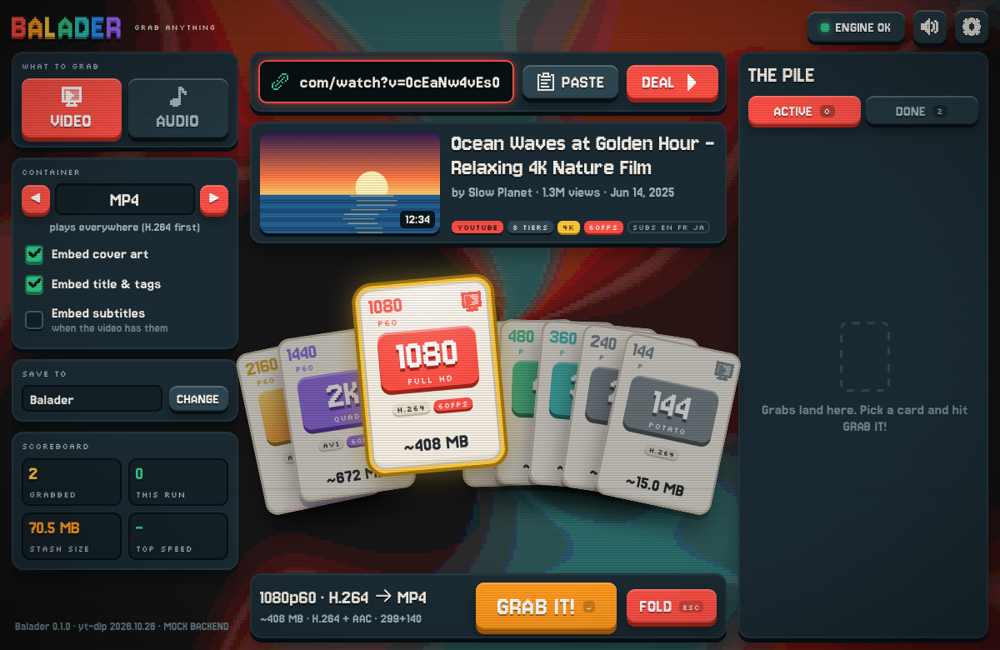
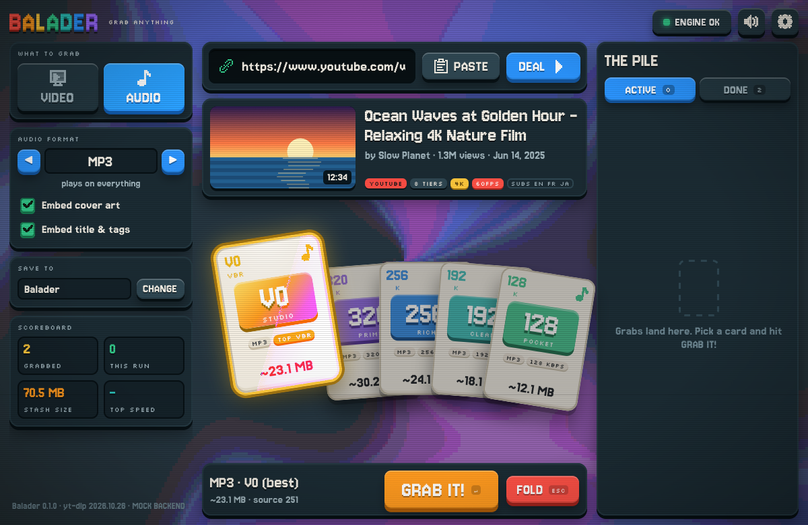
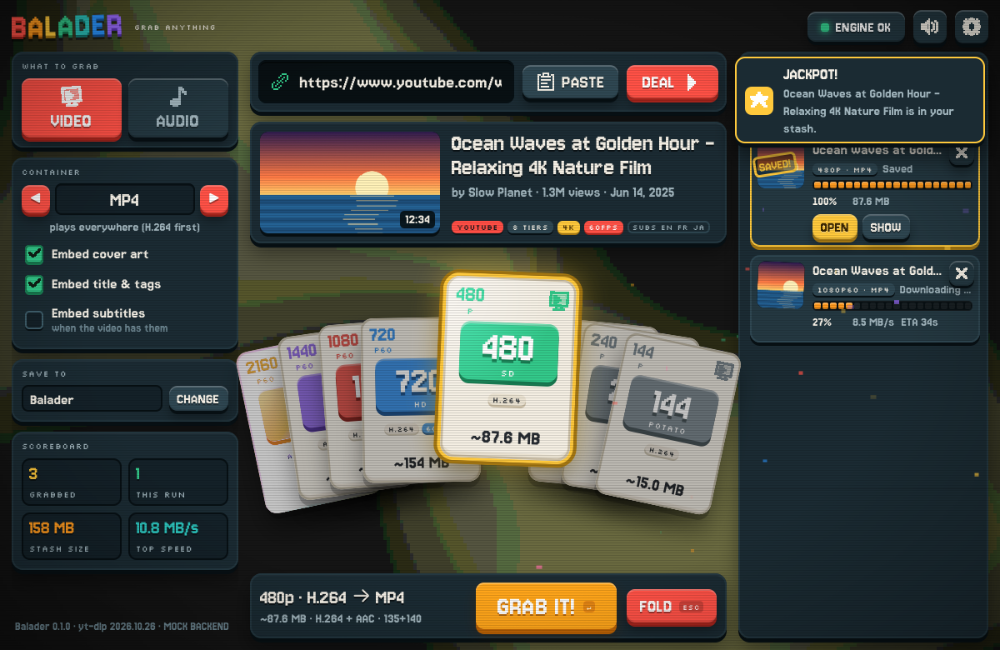
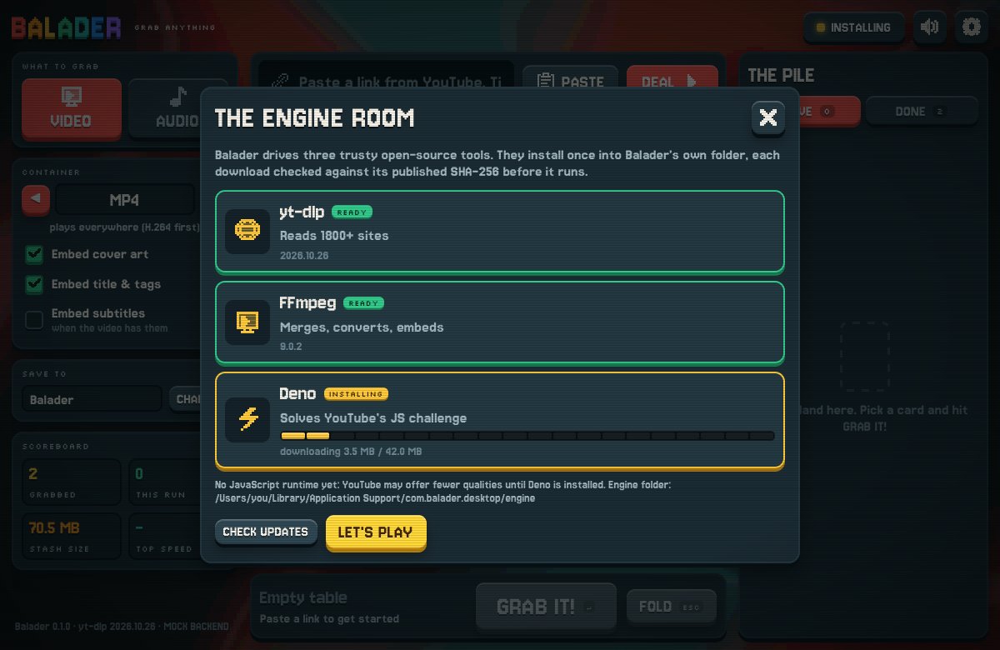

# Balader

**Grab any video or sound, card-table style.** Paste a link from YouTube, TikTok, Instagram, X, SoundCloud, Twitch, Reddit or 1800+ other sites: Balader reads it and deals one card per quality. Pick a card, hit **GRAB IT!**, keep the file.

Built in **Rust** (Tauri 2) for **macOS and Windows**, with a juicy pixel-art UI: swirling paint background, CRT scanlines, cards that deal, flip, tilt and bounce, synthesised sound effects, confetti on every jackpot.



| Audio mode | A grab lands | Engine room |
| --- | --- | --- |
|  |  |  |

## What it does

- **Any site**: [yt-dlp](https://github.com/yt-dlp/yt-dlp) under the hood (1800+ extractors), plus Balader's own Rust page scraper as a fallback for sites with no extractor (Open Graph tags, `<video>` tags, JSON-LD, raw media URLs).
- **Pick the quality**: one card per resolution (4K, 1440, 1080, 720…), each showing codec, frame rate, HDR and the real size.
  - **MP4** favours H.264 + AAC (plays in QuickTime, Windows, editors); **MKV** keeps the original AV1/VP9/Opus.
  - Vertical videos (TikTok, Shorts) are labelled by their short side, like `yt-dlp -S res`.
- **Sound only**: MP3 (V0, 320, 256, 192, 128), M4A or Opus straight from the source tracks (no re-encode), FLAC or WAV.
- **Playlists and channels**, with generic quality cards that apply to every item.
- A download queue (parallel limit), cancel/retry, history, cover art + tags + subtitles embedding, cookies from your browser for sign-in/bot-check videos.
- **Safe by design**: yt-dlp works in a private staging folder; Balader moves finished files into your folder itself and never overwrites anything (a clash becomes `Title (2).mp4`).
- **Engine room**: yt-dlp, FFmpeg and Deno are installed on first run from their official releases, each checked against its published SHA-256, and kept fresh (yt-dlp auto-updates when idle).

## Get it running

Prerequisites: [Rust](https://rustup.rs) (stable), Node.js 20+.

```bash
npm install
npm run app          # dev app with hot reload
npm run app:build    # release bundles in target/release/bundle/
```

On first launch the **Engine Room** opens: one click installs the three tools (~160 MB) into Balader's own folder:

| | macOS | Windows |
| --- | --- | --- |
| Engine | `~/Library/Application Support/com.balader.desktop/engine` | `%LOCALAPPDATA%\com.balader.desktop\engine` |
| Settings | `~/Library/Application Support/com.balader.desktop/settings.json` | `%APPDATA%\com.balader.desktop\settings.json` |
| Downloads | `~/Downloads/Balader` (changeable) | `Downloads\Balader` (changeable) |

**Windows builds** come from CI (`.github/workflows/build.yml` builds the NSIS `.exe` and `.msi` on a Windows runner, plus a universal macOS `.dmg`). Building locally on Windows works the same: `npm install && npm run app:build` (needs the WebView2 runtime, preinstalled on Windows 10/11).

**macOS signing**: bundles are ad-hoc signed. A build downloaded from the internet needs a right-click → Open the first time (or System Settings → Privacy & Security → Open Anyway). Notarize with an Apple Developer ID for distribution.

## How it fits together

```text
 UI (TypeScript, no framework)          src/
   ├─ api/backend.ts  one interface, three implementations:
   │    tauri.ts  → the desktop app (IPC)
   │    http.ts   → `balader serve` (real engine in any browser)
   │    mock/     → deterministic simulator (dev + tests)
   ├─ state/      store, actions, card model
   ├─ ui/         table, hand of cards, pile, HUD, modals
   └─ fx/         WebGL swirl, particles, springs, synth sounds

 Rust core                              crates/balader-core/
   Core::dispatch(cmd, json) ── one command contract for everyone
   ├─ engine.rs   find / install / verify / update yt-dlp, ffmpeg, deno
   ├─ probe.rs    "deal": yt-dlp -J (+ sniff.rs scraper fallback)
   ├─ formats.rs  raw formats → quality tiers (MP4 + MKV picks) + audio tracks
   ├─ selector.rs request → exact yt-dlp arguments (pure, unit-tested)
   ├─ download.rs queue, child processes, progress parsing, safe delivery
   └─ store.rs    settings + history (atomic JSON)

 Shells
   src-tauri/          desktop app (+ debug-only dev bridge)
   crates/balader-cli/ `balader` CLI + `balader serve` (HTTP/SSE)
```

TypeScript types for every message are generated from the Rust structs ([ts-rs](https://github.com/Aleph-Alpha/ts-rs)), so UI and engine can't drift apart: `npm run bindings`.

## Testing

Five layers, all runnable from the terminal (see [TESTING.md](TESTING.md) for the details):

```bash
npm test                 # typecheck + Rust + unit + e2e (WebKit & Chromium, mock)
npm run test:e2e:real    # real engine end to end (network)
npm run test:shots       # visual tour → tests/e2e/.output/shots/*.png
npm run cli -- probe https://youtu.be/…      # the engine without the UI
npm run bridge -- state                       # drive the running desktop app
```

## Troubleshooting

- **"The site wants to check you're human"** (YouTube bot check / HTTP 429): YouTube throttles some networks. Wait a few minutes, or set **Settings → Cookies from** to a browser where you are signed in.
- **"This one needs you to be signed in"** (private, age-gated, Instagram, Vimeo): same fix, cookies from your browser.
- **Fewer YouTube qualities than expected**: make sure Deno shows READY in the engine room (YouTube's JavaScript challenge needs it).
- **A video plays without picture in QuickTime**: choose MP4 (H.264 is preferred there); 4K/1440 on YouTube only exist as AV1/VP9, which QuickTime may not play. VLC plays everything.

## Credits & licences

Balader is MIT licensed. It downloads and runs [yt-dlp](https://github.com/yt-dlp/yt-dlp) (Unlicense), [FFmpeg](https://ffmpeg.org) (GPL builds by [yt-dlp/FFmpeg-Builds](https://github.com/yt-dlp/FFmpeg-Builds) on Windows and [Martin Riedl](https://ffmpeg.martin-riedl.de) on macOS) and [Deno](https://deno.com) (MIT). Fonts: Jersey 10 / Jersey 15 and Silkscreen (SIL Open Font License). All sounds are synthesised at runtime.

Only grab what you have the right to keep: your own uploads, public-domain and Creative Commons works, or content whose creator allows offline copies. Respect each platform's terms.
